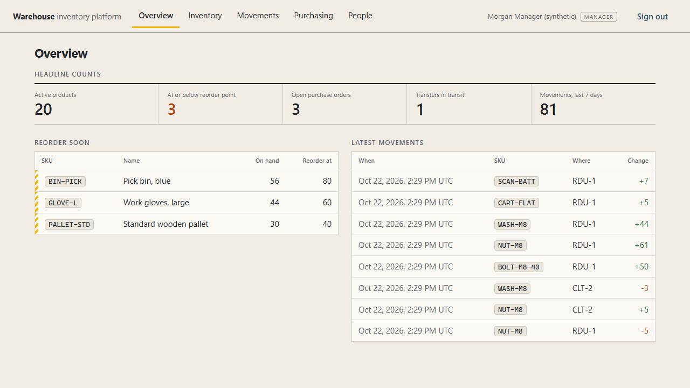
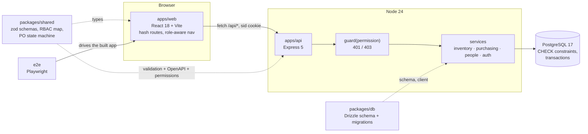
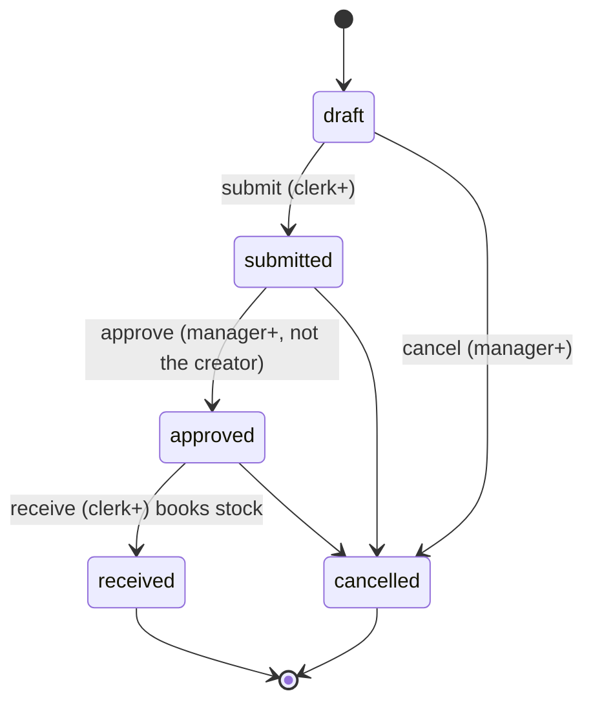

# warehouse-inventory-platform

[](https://github.com/dc-tech-inc/warehouse-inventory-platform/actions/workflows/ci.yml)
[](LICENSE)

A full-stack TypeScript reference for the back office of a small distribution business: **inventory, stock movements and warehouse transfers, purchasing, employees and rewards**, behind role-based access. React and Express on PostgreSQL, one `docker compose up` to run it, browser tests that drive the real UI.

Built and maintained by **DCtech.** as an engineering reference. It is a demo, not a product: every record in it is **synthetic** and it is not deployed anywhere.



<sub>Screenshots in this repository are produced by the Playwright tests (`e2e/tests/tour.spec.ts`), not by hand.</sub>

## What it does

| Module | What you can do | Who (default roles) |
|---|---|---|
| **Inventory** | Products with SKU, unit, reorder point and cost; stock per warehouse; search, low-stock filter, pagination | everyone reads, managers write |
| **Movements** | Book receipts and issues; managers book signed adjustments (note required); full history | clerk: receipt/issue, manager: + adjustment |
| **Transfers** | Move stock between warehouses: it leaves the source immediately, lands on *receive*, returns on *cancel* | clerk and up |
| **Purchasing** | Suppliers, purchase orders with lines; `draft → submitted → approved → received` (cancel until received); receiving books one receipt per line | clerk raises and receives, manager approves |
| **Employees** | Employee records (synthetic) | manager and up |
| **Rewards** | Points ledger: award, redeem against a catalog, recognition board | manager awards, admin manages the catalog |
| **Accounts** | Admin creates accounts and changes roles. There is no public sign-up | admin |

Rules the code enforces (and the tests check):

- Stock never goes negative: an issue larger than what is on hand is a `409`, and ten concurrent issues for five units book exactly five.
- Stock on hand always equals the sum of all movements, including transfers in transit.
- You cannot approve a purchase order you created, not even as admin.
- Redeeming points locks the employee row, so concurrent redemptions cannot spend the same points twice.
- A role is read from the database on every request; promoting a user applies to their live session.

## Run it

```sh
docker compose up
```

Open <http://localhost:3000>. The first start applies the migrations and loads synthetic demo data. Demo logins (password `demo-password-12345`, synthetic accounts on the reserved `example.test` domain):

| Role | Email |
|---|---|
| admin | `admin@example.test` |
| manager | `manager@example.test` |
| clerk | `clerk@example.test` |

Without Docker, with any PostgreSQL 17 you have (Node 24+, pnpm 11):

```sh
cp .env.example .env            # set DATABASE_URL
pnpm install
pnpm db:migrate
pnpm db:seed                    # synthetic demo data, skipped if the database already has data
pnpm dev                        # API :3000, web http://localhost:5173 (Vite proxies /api)
```

## Architecture





```
apps/api/    src/{app,server,env,openapi,seed}.ts, middleware/, routes/, services/; test/{unit,integration}
apps/web/    src/{App,hooks,ui,format}.ts(x), api/client.ts, features/*; test/
packages/db/ src/schema.ts, drizzle/ (committed SQL migrations)
packages/shared/  zod schemas, rbac.ts, purchasing.ts (state machine)
e2e/         Playwright tests, DB reset + seed, screenshot tour
docs/        adr/ (decisions), screenshots/ (generated)
```

Request path in the API: `pino-http` → `helmet` → `cors` → `express.json` (100 kB) → `/health` → global rate limiter → routers → static web app (when `WEB_DIST` is set) → 404 → error handler.

## API

OpenAPI 3.1 document at `GET /openapi.json`, generated from the same zod schemas the routes validate with. Highlights:

| Area | Endpoints |
|---|---|
| Auth | `POST /api/auth/login`, `POST /api/auth/logout`, `GET /api/auth/me` |
| Accounts (admin) | `GET/POST /api/users`, `PATCH /api/users/{id}` |
| Inventory | `GET /api/dashboard`, `GET/POST /api/warehouses`, `GET/POST /api/products`, `GET/PATCH /api/products/{id}` |
| Movements | `GET/POST /api/movements` (receipt, issue, adjustment) |
| Transfers | `GET/POST /api/transfers`, `POST /api/transfers/{id}/receive`, `.../cancel` |
| Purchasing | `GET/POST /api/suppliers`, `GET/POST /api/purchase-orders`, `GET /api/purchase-orders/{id}`, `POST .../{submit,approve,receive,cancel}` |
| People | `GET/POST /api/employees`, `GET/PATCH /api/employees/{id}` |
| Rewards | `GET/POST /api/rewards/catalog`, `GET /api/rewards/leaderboard`, `GET /api/employees/{id}/rewards`, `POST .../rewards/{award,redeem}` |

Lists are paginated (`?limit=1..100&offset=`) and return `{ items, total }`. Every error has one shape:

```json
{ "error": { "code": "CONFLICT", "message": "Insufficient stock", "details": { "available": 4, "requested": 5 } } }
```

`code` is one of `VALIDATION_ERROR`, `UNAUTHORIZED`, `FORBIDDEN`, `NOT_FOUND`, `CONFLICT`, `RATE_LIMITED`, `INTERNAL`. A 500 always says `Internal server error`; the cause goes to the log only.

## Tests

```sh
pnpm lint && pnpm typecheck
pnpm test             # shared + api (unit and Postgres integration) + web (jsdom)
pnpm test:coverage    # same, with v8 coverage of apps/api/src
pnpm --filter @app/e2e exec playwright install chromium   # once
pnpm --filter @app/e2e test                               # Playwright against the built app
```

The API integration tests and the e2e run need a PostgreSQL database whose name contains `test` (or `e2e`); they drop and recreate its schema and refuse any other name. Without `DATABASE_URL` the integration tests are skipped and the run prints why.

Measured by CI (run [39801665217](https://github.com/dc-tech-inc/warehouse-inventory-platform/actions/runs/39801665217), against `postgres:17`):

- **133 unit and integration tests** in 15 files: shared 35, api 78 (of which the Postgres integration tests run for real, none skipped), web 20 (jsdom).
- **6 Playwright e2e tests** in Chromium against the built app.
- Coverage of `apps/api/src` (v8): **92.3% lines, 90.7% statements, 81.1% branches, 94.5% functions**. The lowest-covered files are the process entrypoints (`server.ts`, `seed-cli.ts`, `bootstrap.ts`), which the tests do not start.
- The `docker compose up` smoke job builds the image, waits for the health check, logs in as the manager and reads the dashboard.

## Design decisions

Short records live in [`docs/adr`](docs/adr):

1. [Start from `ts-fullstack-starter`](docs/adr/0001-start-from-the-starter.md)
2. [RBAC as a permission map in the shared package](docs/adr/0002-rbac-permission-map.md)
3. [Stock changes are one transaction and a guarded UPDATE](docs/adr/0003-stock-changes-are-guarded-updates.md)
4. [Purchase orders are a small state machine with separation of duties](docs/adr/0004-purchase-order-state-machine.md)
5. [UI direction: a ledger, not a dashboard of cards](docs/adr/0005-ui-direction.md)

## Limitations

- **Synthetic demo.** All products, suppliers, employees and accounts are invented. The employee and rewards modules model HR-style workflows, not real HR data, and have no payroll, leave or personal-data handling.
- No email, password reset, SSO, MFA or audit-log export. Sessions are server-side with a 24-hour lifetime; there is no "remember me" or session list.
- Single currency (USD), integer cents; no taxes, landed cost or supplier price lists.
- Stock is tracked per product and warehouse; there are no bins/locations, lots, serial numbers or reservations.
- A transfer in transit is not counted in either warehouse. Partial receipts of a purchase order are not supported (it is received whole or not at all).
- No CSRF token: protection relies on `SameSite=Lax` cookies plus JSON-only endpoints. Add a token if the API is ever served cross-site.
- The rate limiter is in memory, per process; several instances need a shared store.
- Hash-based routing and no code splitting: fine for this size, not tuned for large catalogs. The web app has no offline mode.
- Timestamps are shown in UTC.
- The container is a single-stage image running as the `node` user with the full dependency tree; it is meant for evaluation, not for production hardening.

## Roadmap

Tracked as issues: partial purchase-order receipts, bin locations, an audit-trail view, CSV import/export.

## Docs used

- Express 5 migration guide: https://expressjs.com/en/guide/migrating-5.html
- Drizzle ORM, PostgreSQL: https://orm.drizzle.team/docs/get-started/postgresql-new · schema: https://orm.drizzle.team/docs/sql-schema-declaration · migrations: https://orm.drizzle.team/docs/migrations · transactions: https://orm.drizzle.team/docs/transactions
- PostgreSQL explicit locking (`SELECT … FOR UPDATE`): https://www.postgresql.org/docs/17/explicit-locking.html · check constraints: https://www.postgresql.org/docs/17/ddl-constraints.html
- zod 4: https://zod.dev/ · zod-to-openapi: https://github.com/asteasolutions/zod-to-openapi
- OWASP Password Storage Cheat Sheet: https://cheatsheetseries.owasp.org/cheatsheets/Password_Storage_Cheat_Sheet.html
- helmet: https://helmet.js.org/ · express-rate-limit: https://express-rate-limit.mintlify.app/reference/configuration
- React 18: https://react.dev/ · Vite: https://vite.dev/guide/ · Testing Library: https://testing-library.com/docs/react-testing-library/intro/
- Vitest coverage: https://vitest.dev/guide/coverage · supertest: https://github.com/forwardemail/supertest
- Playwright web server: https://playwright.dev/docs/test-webserver · CI: https://playwright.dev/docs/ci · screenshots: https://playwright.dev/docs/screenshots
- Docker Compose: https://docs.docker.com/compose/ · `up --wait`: https://docs.docker.com/reference/cli/docker/compose/up/ · Dockerfile reference: https://docs.docker.com/reference/dockerfile/
- GitHub Actions service containers: https://docs.github.com/en/actions/tutorials/use-containerized-services/create-postgresql-service-containers
- Dependabot configuration: https://docs.github.com/en/code-security/dependabot/working-with-dependabot/dependabot-options-reference
- gitleaks: https://github.com/gitleaks/gitleaks
- Mermaid: https://mermaid.js.org/syntax/stateDiagram.html

## License

MIT, see [LICENSE](LICENSE). Copyright (c) 2026 DC TECH INC.
